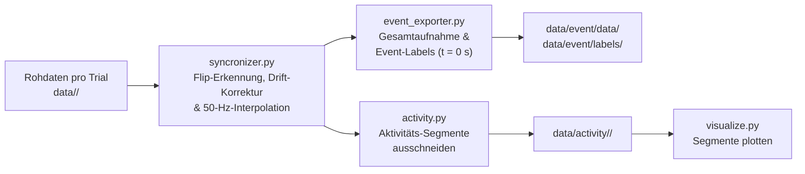

# Preprocessing-Dokumentation

Diese Anleitung beschreibt den Aufbau, die Funktionsweise und die Nutzung der Preprocessing-Pipeline unter `src/pre-processing/`. Ziel der Pipeline ist es, rohe Sensoraufnahmen (Accelerometer + Gyroskop mehrerer Gelenke) zeitlich zu synchronisieren, auf ein einheitliches Zeitraster zu bringen und in trainingsfertige **Event-** und **Aktivitäts-Datensätze** zu exportieren.

---

## Überblick



Alle Schritte werden zentral über **`src/pre-processing/pipeline.py`** gesteuert.

---

## Schnellstart

Alle Befehle werden aus dem Projekt-Root ausgeführt (`uv run ...`):

```powershell
# 1. Alle gültigen Trial-Ordner in data/ verarbeiten
uv run src/pre-processing/pipeline.py

# 2. Nur einen einzelnen Trial-Ordner verarbeiten
uv run src/pre-processing/pipeline.py data/20261117_P03_S03_SC01

# 3. Exportierte Segmente einer Aktivität visualisieren (z. B. walking, squats)
uv run src/pre-processing/visualize.py walking
```

---

## Erwartete Eingabestruktur (Rohdaten)

Jede Messung (Trial) liegt in einem eigenen Ordner unter `data/<trial_id>/` und folgt dieser Namenskonvention:

```text
data/
└── 20261117_P03_S03_SC01/
    ├── 20261117_P03_S03_SC01_labels.csv
    ├── 20261117_P03_S03_SC01_left_wrist_acc.csv
    ├── 20261117_P03_S03_SC01_left_wrist_gyro.csv
    ├── 20261117_P03_S03_SC01_right_wrist_acc.csv
    ├── 20261117_P03_S03_SC01_right_wrist_gyro.csv
    ├── 20261117_P03_S03_SC01_torso_acc.csv
    ├── 20261117_P03_S03_SC01_torso_gyro.csv
    ├── 20261117_P03_S03_SC01_right_thigh_acc.csv
    └── 20261117_P03_S03_SC01_right_thigh_gyro.csv
```

### Erwartete Spalten
- **`*_labels.csv`**: `trial_id, subject, label, type, start_s, end_s, duration_s, start_time, end_time`
  - Muss mindestens **zwei** Einträge mit `label == "sync_flip"` enthalten (Anfangs- und End-Flip der Messung).
  - `type` unterscheidet zwischen `"activity"` (mit `start_s` und `end_s`) und `"event"` (Punkt-Event mit `start_s`).
- **`*_<joint>_acc.csv`**: `epoch_ms, acc_x_g, acc_y_g, acc_z_g`
- **`*_<joint>_gyro.csv`**: `epoch_ms, gyro_x_dps, gyro_y_dps, gyro_z_dps`

Standard-Gelenke (`DEFAULT_JOINTS`): `("left_wrist", "right_wrist", "torso", "right_thigh")`.

---

## Erzeugte Ausgabestruktur (Trainingsdaten)

Nach dem Lauf von `pipeline.py` entsteht folgende Ordnerstruktur unter `data/`:

```text
data/
├── event/
│   ├── data/
│   │   └── <trial_id>.csv                                  # Gesamtaufnahme (50 Hz, ab 0.0 s)
│   └── labels/
│       └── <trial_id>_events.csv                           # Event-Labels (t = 0 s am 1. sync_flip)
└── activity/
    ├── walking/
    │   └── <trial_id>_walking_<start>_<end>.csv            # Ausgeschnittene Segmente
    ├── sitting/
    ├── jumping_jacks/
    └── ...
```

### Spalten-Schema der synchronisierten CSVs
Sowohl `data/event/data/<trial_id>.csv` als auch jede Datei unter `data/activity/<label>/` haben exakt dasselbe **25-Spalten-Schema** bei konstant **50 Hz** (`dt = 0.02 s`):

- `time_s`: Zeit in Sekunden, startet bei **`0.0`** am ersten `sync_flip` und endet beim letzten `sync_flip`.
- Für jedes Gelenk (`left_wrist`, `right_wrist`, `torso`, `right_thigh`) jeweils 6 Kanäle:
  - `<joint>_acc_x_g`, `<joint>_acc_y_g`, `<joint>_acc_z_g`
  - `<joint>_gyro_x_dps`, `<joint>_gyro_y_dps`, `<joint>_gyro_z_dps`

---

## Die Module im Detail

### 1. `src/pre-processing/pipeline.py` (Haupt-Einstiegspunkt)
Verbindet alle Schritte in einem Durchlauf:
- **`process_trial(trial_dir, output_root="data", target_hz=50.0, ...)`**:
  1. Lädt Rohdaten und Labels über `load_trial`.
  2. Synchronisiert alle Gelenke über `synchronize_trial`.
  3. Exportiert Gesamtaufnahme + Event-Labels über `save_event_data`.
  4. Verschiebt die Label-Zeiten via `shift_times_to_sync_flip` auf `0.0 s` und schneidet alle `"activity"`-Abschnitte mit `extract_activity` aus.
- **`process_all_trials(data_root="data", output_root="data", target_hz=50.0)`**:
  Findet über `find_trial_dirs` automatisch alle Unterordner mit `<ordnername>_labels.csv` und verarbeitet sie nacheinander.

**Beispiel in Python:**
```python
from pipeline import process_trial, process_all_trials

summary = process_trial("data/20261117_P03_S03_SC01", target_hz=50.0)
```

---

### 2. `src/pre-processing/syncronizer.py` (Synchronisation & Resampling)
Behebt Zeitversatz, individuellen Uhrendrift (Clock-Drift) und leicht unterschiedliche Abtastraten zwischen den einzelnen Sensoren.

**Funktionsweise pro Gelenk:**
1. **Flip-Erkennung (`detect_flip`)**: Erkennt auf `acc_z_g` über ein gleitendes Fenster und eine Stufen-Korrelation die zwei Wechsel von `+1 g` auf `-1 g` (`sync_flip` am Anfang und Ende).
2. **Plausibilitätsprüfung**: Vergleicht die gemessene Dauer zwischen den beiden Flips mit der Dauer aus `labels.csv`. Bei fehlenden Daten, `< 2` erkannten Flips oder einer Abweichung `> max_duration_diff_s` (Standard: `5.0 s`) wird eine `UserWarning` ausgegeben und alle 6 Spalten des Gelenks werden mit **`NaN`** gefüllt – so bleibt das Spalten-Schema für nachgelagerte ML-Pipelines immer konsistent.
3. **Lineare Zeitkorrektur & Interpolation (`_align_and_interpolate`)**:
   - Die `epoch_ms`-Zeitstempel von **Acc und Gyro** desselben Gelenks werden anhand der erkannten Acc-Flip-Zeiten linear auf `[0.0, duration_s]` abgebildet (korrigiert Offset + Clock-Drift, ohne echte Lücken zu verzerren).
   - Alle Gelenke werden linear (`np.interp`) auf **ein gemeinsames festes Zeitraster** (`target_hz=50.0`) interpoliert.
   - **Lückenschutz (`max_gap_s=0.25`)**: Bei Datenaussetzern größer als 0,25 s wird im Zielraster `NaN` gesetzt, statt über fehlende Messungen hinweg zu interpolieren.

**Wichtige Funktionen:**
- `load_trial(trial_dir, joint_names=DEFAULT_JOINTS)` → lädt `(joints, df_labels)`.
- `synchronize_trial(joints, df_labels, target_hz=50.0, max_duration_diff_s=5.0, max_gap_s=0.25)` → gibt ein einzelnes synchronisiertes `pd.DataFrame` zurück.
- `plot_flips(df_acc, df_labels)` → Debug-Plot zur visuellen Kontrolle der erkannten Flips vs. gespeicherten Labels.

**Beispiel in Python:**
```python
from syncronizer import load_trial, synchronize_trial

joints, df_labels = load_trial("data/20261117_P03_S03_SC01")
df_synced = synchronize_trial(joints, df_labels, target_hz=50.0)
```

---

### 3. `src/pre-processing/event_exporter.py` (Event-Export)
Bereitet die Gesamtaufnahme und die Event-Zeitpunkte für Event-Detection-Modelle auf:
- **`shift_times_to_sync_flip(labels_df, sync_label="sync_flip")`**: Verschiebt `start_s` und `end_s` so, dass der erste `sync_flip` bei `0.0 s` liegt (exakt passend zu `time_s` aus `synchronize_trial`).
- **`extract_event_labels(labels_df, exclude_labels=("sync_flip", "sync_flip_back"), ...)`**: Filtert `type == "event"`, entfernt die Sync-Flips und ergänzt `epoch_ms`.
- **`save_event_data(sensor_df, labels=..., trial_id=..., data_dir=..., label_dir=...)`**: Speichert `<trial_id>.csv` und `<trial_id>_events.csv`.

---

### 4. `src/pre-processing/activity.py` (Aktivitäts-Export)
Schneidet einzelne Aktivitäts-Abschnitte aus dem synchronisierten DataFrame aus:
- **`extract_activity(df, activity, start_time, end_time, save_path, time_col="time_s", trial_id=None)`**:
  Filtert `start_time <= df[time_col] <= end_time` und speichert das Segment als CSV unter `<save_path>/<activity>/<trial_id>_<activity>_<start>_<end>.csv`.

---

### 5. `src/pre-processing/visualize.py` (Visualisierung)
Plottet die `x/y/z`-Beschleunigung aller Gelenke für eine exportierte Aktivität (ein Subplot pro Gelenk, eine Figure pro Segment):

```powershell
# Alle Segmente einer Aktivität aus data/activity/<label>/ plotten
uv run src/pre-processing/visualize.py squats
```

**In Python:**
```python
from visualize import plot_activity

figs = plot_activity("walking", joints=("left_wrist", "torso", "right_thigh"), show=True)
```

---

### 6. `src/pre-processing/importer.py` (Rohdaten-Konvertierung, optional)
Hilfsmodul zum Umwandeln älterer/roher Sensorformate (`.cwa` / `.wav` via `OmConvert` oder rohe `ax6`/`mbient`-CSVs) in DataFrames. Wird von der aktuellen `pipeline.py` nicht direkt benötigt, solange die Trial-Ordner bereits als `*_acc.csv` / `*_gyro.csv` vorliegen.

---

## Hinweise & Troubleshooting

- **Warnung `Weniger als 2 sync_flips erkannt` oder `Dauer-Abweichung zu groß`**:
  Tritt auf, wenn ein Sensor abgebrochen ist (z. B. Bluetooth-Verbindung verloren) oder keinen klaren Start-/End-Flip enthält. Die Pipeline bricht nicht ab, sondern füllt die 6 Spalten dieses Gelenks mit `NaN`.
- **`NaN`-Werte in den exportierten CSVs**:
  Entstehen bewusst entweder durch einen ausgefallenen Sensor (gesamte Spalten `NaN`) oder durch kurzzeitige Paketverluste `> max_gap_s` (`0.25 s`). Beim Training sollten Modelle bzw. Windowing-Schritte entsprechend mit `NaN` umgehen (z. B. Fenster mit `NaN` filtern oder gezielt imputieren).
- **Zeitbasis (`time_s` vs. `start_s`)**:
  In allen exportierten Dateien (`event/data/`, `event/labels/`, `activity/`) entspricht `0.0 s` dem ersten `sync_flip`. Die `start_s`-Werte in `*_events.csv` zeigen daher direkt auf die passende Stelle in `time_s` der zugehörigen `<trial_id>.csv`.
